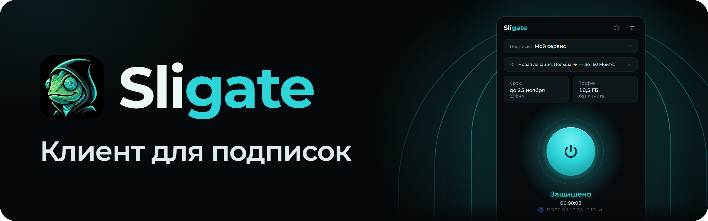
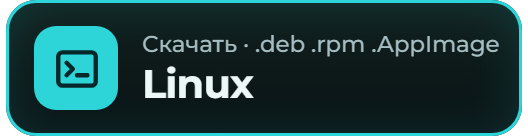
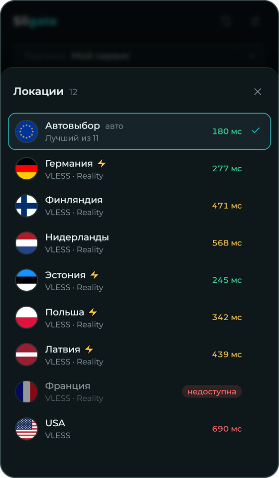
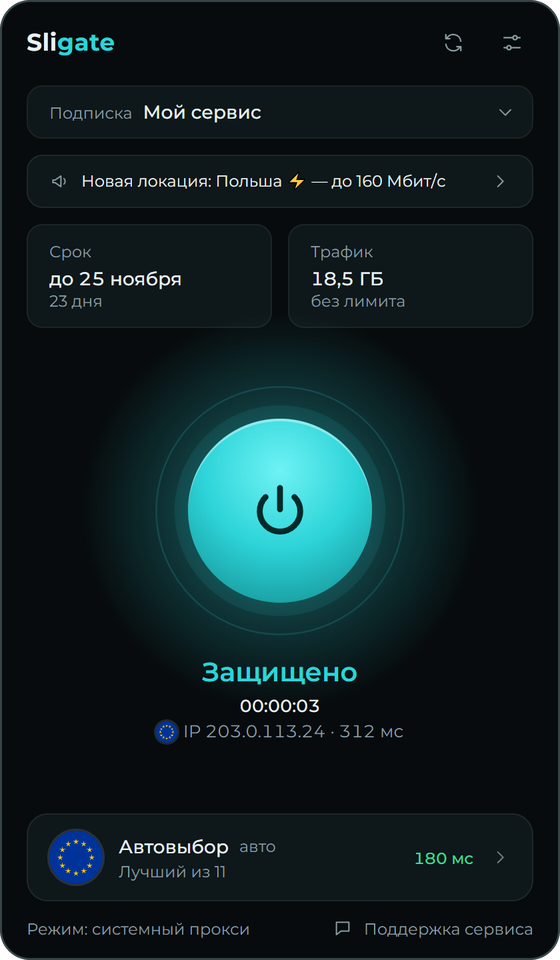
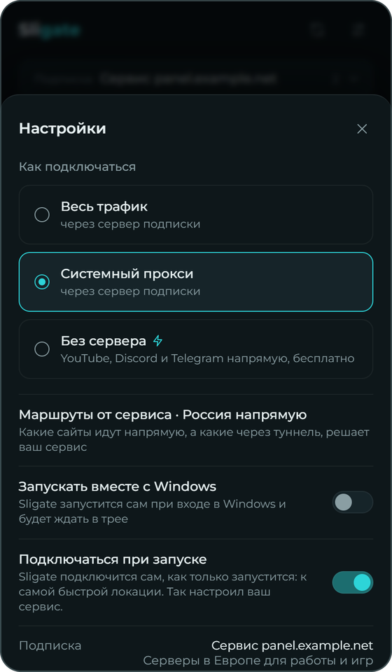

  

<b>Подключение к вашему сервису по ссылке подписки.</b>

  
  
  

  
  
  

После установки вставьте ссылку подписки от вашего сервиса и нажмите большую кнопку.

  &nbsp;
  &nbsp;
  

## Возможности

<table>
  <tr>
    <td width="40"></td>
    <td><b>Подписки любых сервисов</b> Remnawave, Marzban, 3x-ui и другие панели. Несколько подписок, переключение в один клик.</td>
  </tr>
  <tr>
    <td width="40"></td>
    <td><b>Автовыбор и честный пинг</b> Самый быстрый сервер, пинг через сам сервер, неработающие помечены «недоступна».</td>
  </tr>
  <tr>
    <td width="40"></td>
    <td><b>Прокси или весь трафик</b> Компьютеры: прокси или «Весь трафик» для всех программ и игр. Телефоны и ТВ: весь трафик.</td>
  </tr>
  <tr>
    <td width="40"></td>
    <td><b>Обновляется сам</b> Компьютеры: скачивает новую версию и проверяет подпись. Android: предлагает скачать.</td>
  </tr>
  <tr>
    <td width="40"></td>
    <td><b>Android TV</b> Управление с пульта, подписку можно отправить с телефона по QR-коду.</td>
  </tr>
  <tr>
    <td width="40"></td>
    <td><b>Режим «Без сервера» (только Windows)</b> YouTube и Discord напрямую, без сервера и без подписки, бесплатно.</td>
  </tr>
</table>

## Платформы

| Платформа | Скачать |
|---|---|
| Windows 10/11, x64 | [`.exe`](https://github.com/SligWORK/sligate/releases/latest/download/Sligate-x64-setup.exe) |
| Android 8+ и Android TV | [`.apk`](https://github.com/SligWORK/sligate/releases/latest/download/Sligate-android.apk) |
| Linux x64 | [`.deb`, `.rpm`, `.AppImage`](https://github.com/SligWORK/sligate/releases/latest) |
| macOS | скоро |
| iPhone и iPad | скоро |

Все версии: [Releases](https://github.com/SligWORK/sligate/releases) · Сайт: [sligate.cc](https://sligate.cc)

## Подробнее

<b>Установка и файлы релиза</b>

- **Windows:** скачайте `Sligate-x64-setup.exe` и запустите. SmartScreen может предупредить о неизвестном издателе: «Подробнее» → «Выполнить в любом случае».
- **Linux:** `.deb` — Ubuntu/Debian (`sudo apt install ./Sligate_<версия>_amd64.deb`), `.rpm` — Fedora (`sudo dnf install ./Sligate-<версия>-1.x86_64.rpm`), `.AppImage` — без установки, только режим прокси.
- **Android и Android TV:** скачайте `Sligate-android.apk` и разрешите установку из этого источника.

Версии 0.1 и 0.2.0 не умеют обновляться сами — один раз поставьте новую поверх, дальше обновления придут автоматически.

Файлы `module-*.zip`, `pack-*.zip` и `pack.json` в релизах служебные: их скачивает сама программа для режима «Без сервера», вручную скачивать их не нужно.

Проверить файл: SHA-256 каждого файла указан в описании релиза.

<b>Режим «Без сервера» (только Windows)</b>

YouTube и Discord напрямую, без сервера и без подписки, бесплатно. Файлы режима, около 7 МБ, скачиваются при первом включении. Telegram работает в приложении для компьютера, пока открыт Sligate. Звонки в Telegram режим не чинит, а перед игрой с античитом его нужно выключить.

<b>Ещё возможности</b>

- Полные конфиги Xray (XRAY_JSON) и ссылки `vless://`, `trojan://`, `ss://`, `vmess://`, `hysteria2://`, `socks://`.
- **Подписка грузится даже при блокировке её адреса**: запасные адреса от сервиса и загрузка через уже поднятое подключение.
- **Подключаться при запуске** — к последней, самой быстрой или любой доступной локации.
- «Российские сайты — напрямую» для подписок без своих правил.
- Системный прокси работает без прав администратора. В режиме «Весь трафик» DNS через туннель.
- Лимит устройств Remnawave (HWID) поддерживается.

<b>Безопасность</b>

- Подписки хранятся на вашем устройстве, ID устройства отправляется только в панель вашего сервиса (для лимита устройств). Сторонней телеметрии нет. Разработчику уходят только отметка раз в день (версия и система, без номера устройства) и отчёт о проблеме, если вы сами его отправите. Подробно: [политика конфиденциальности](https://sligate.cc/privacy/).
- Обновления для компьютеров подписаны ключом разработчика и проверяются перед установкой.
- Локальные порты закрыты от других программ: SOCKS — только с одноразовым паролем, служебный API ядра не открывается. Подключение в режиме «Весь трафик» локальных портов не открывает. Единственное исключение — локальный прокси Telegram (`127.0.0.1`, только с секретом), если вы сами нажали кнопку Telegram в режиме «Без сервера».
- Ссылка `sligate://` никогда не добавляет подписку без вашего подтверждения.

<b>Для владельцев сервисов</b>

Чтобы подписчики получали в Sligate полный конфиг (балансер, ваши правила роутинга), добавьте в Remnawave одно правило ответа подписки: заголовок `user-agent`, REGEX `^Sligate/` (без учёта регистра) → **XRAY_JSON**, перед «Fallback Base64».

Кнопка в Telegram-боте: `https://sligate.cc/add/#<ссылка подписки, encodeURIComponent>` — страница откроет Sligate с предложением добавить подписку.

Какие настройки сервиса понимает Sligate (название, срок, поддержка, «Продлить», маршруты, запасные адреса, пинг, подключение при запуске) — на [sligate.cc/owners](https://sligate.cc/owners/).

<b>Сторонние компоненты</b>

Sligate использует неизменённые официальные сборки [Xray-core](https://github.com/XTLS/Xray-core) (MPL-2.0), [libXray](https://github.com/XTLS/libXray) (MIT, Android) и [Wintun](https://www.wintun.net/) (WireGuard LLC, Windows). Режим «Без сервера» использует [zapret2](https://github.com/bol-van/zapret2) и [zapret](https://github.com/bol-van/zapret) (MIT), [WinDivert](https://github.com/basil00/WinDivert) (LGPLv3 или GPLv2), [Cygwin](https://cygwin.com) (LGPLv3), способы и списки [zapret-discord-youtube](https://github.com/Flowseal/zapret-discord-youtube) (MIT), а прокси Telegram сделан из [tg-ws-proxy-rs](https://github.com/valnesfjord/tg-ws-proxy-rs) (MIT). Подробности — в [THIRD-PARTY-NOTICES.md](THIRD-PARTY-NOTICES.md).

<a href="https://sligate.cc">sligate.cc</a> · <a href="https://sligate.cc/privacy/">Конфиденциальность</a> · <a href="THIRD-PARTY-NOTICES.md">Сторонние компоненты</a>

